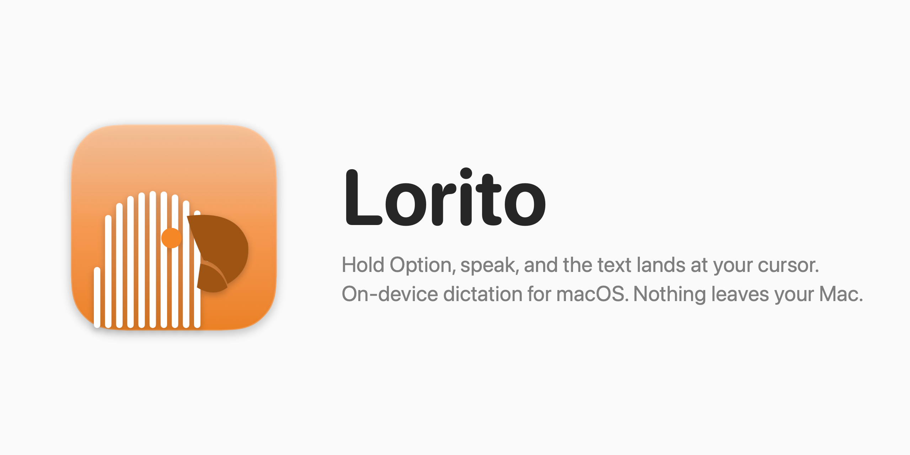

<p align="center"></p>

# Lorito

Lorito repeats exactly what you say, in text. Fast, and all on your Mac.

Lorito is a small dictation app that lives in the menu bar. Hold Left Option and talk, or tap it to talk hands-free. When you stop, the text shows up where your cursor is, in any app, in under a second.

That is the whole app. No window, no account, no settings page. The menu has a microphone picker, a cleanup switch and your last five dictations. After the first launch it never goes online.

Speech recognition uses NVIDIA's [parakeet-tdt-0.6b-v3](https://huggingface.co/nvidia/parakeet-tdt-0.6b-v3) (CC-BY-4.0) through [FluidAudio](https://github.com/FluidInference/FluidAudio) (Apache-2.0) on the Neural Engine. It understands 25 European languages and picks the right one by itself. Cleanup uses Apple's on-device Foundation Models to fix punctuation, drop filler words and apply corrections like "no wait". The source is 788 lines of Swift with one dependency.

## Requirements

- A Mac with Apple Silicon and macOS 26
- Xcode Command Line Tools: `xcode-select --install`
- Apple Intelligence turned on, for cleanup. Without it you get the raw transcript.

## Install

```sh
git clone https://github.com/jorisrombouts/Lorito.git && cd Lorito
./make-signing-cert.sh   # once; asks for your login password
./build-app.sh install
```

The certificate gives the app a fixed identity, so you grant permissions once and they survive updates. To update: `git pull && ./build-app.sh install`.

The first launch downloads the recognition models (461 MB) and compiles them. That takes about 12 seconds; the parrot is in the menu bar but dictation is not ready yet. The app itself is 18 MB. macOS then asks for Microphone and Accessibility. Accessibility is what lets the app paste at your cursor.

## Use

- **Hold** Left Option, talk, let go.
- **Tap** Left Option, talk, tap again. Esc or the ✕ in the pill throws it away. It stops on its own after two minutes without speech.

Pressing any other key while holding cancels, so shortcuts like `€` or `@` still work. A pill at the bottom of the screen shows the sound level while you talk, then what it is doing, then "Inserted" or why the paste failed. Your clipboard is put back after the paste. Dutch and English are tested.

In the microphone picker, "Automatic" is the built-in mic. Bluetooth headsets work when picked but miss the first half second. Dictations under four words are inserted as is. Cleanup never translates and never answers a question.

## Speed

Measured on an M4 Pro, from letting go of the key to text at the cursor. Your own timings are in `~/Library/Logs/Lorito.log`.

| Dictation | Recognition | Cleanup | Total |
|---|---|---|---|
| 3 s | 0.05 s | 0.3 s | 0.35 s |
| 6 s | 0.07 s | 0.4 s | 0.5 s |
| 10 s | 0.2 s | 0.7 s | 0.9 s |
| 22 s | 0.1 s | 0.7 s | 0.85 s |

Cleanup is nearly all of the wait. Turn it off in the menu and only recognition is left.

## Troubleshooting

If the paste does not land, the pill says why. It is the Accessibility permission, and your text is still in the menu. The fix for a stale permission and what the log holds are in `AGENTS.md`.

## Development

A Swift Package, no Xcode project, one dependency. `./build-app.sh` builds and runs `build/Lorito.app`. `./check.sh` is the smoke test. `AGENTS.md` has the rules for changing the code.
