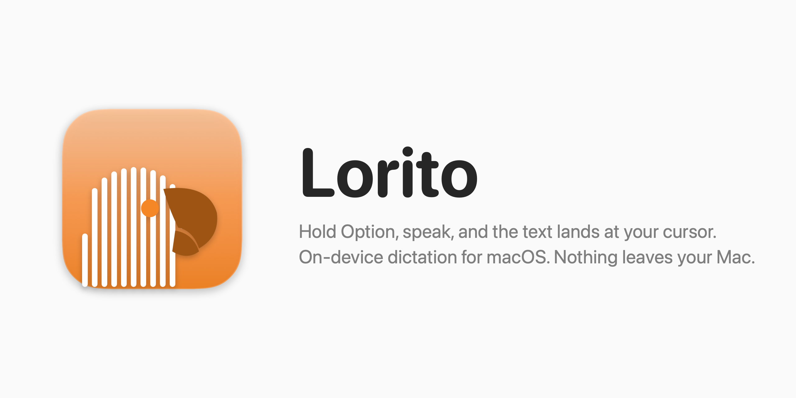

<p align="center"></p>

# Lorito

Lorito repeats exactly what you say, in text. Fast, and all on your Mac.

Lorito is a small dictation app that lives in the menu bar. Hold Left Option and talk, or tap it to talk hands-free. When you stop, the text shows up where your cursor is, in any app, in under a second.

That is the whole app. No account, no subscription. The menu shows your last five dictations; a small Settings window holds the hotkey, the microphone and the cleanup switch. After the first launch it never goes online.

Speech recognition uses NVIDIA's [parakeet-tdt-0.6b-v3](https://huggingface.co/nvidia/parakeet-tdt-0.6b-v3) (CC-BY-4.0) through [FluidAudio](https://github.com/FluidInference/FluidAudio) (Apache-2.0) on the Neural Engine. It understands 25 European languages and picks the right one by itself. Cleanup uses Apple's on-device Foundation Models to fix punctuation, drop filler words and apply corrections like "no wait". The source is 1,442 lines of Swift with one dependency, under the MIT license.

## Requirements

- A Mac with Apple Silicon and macOS 26
- Xcode Command Line Tools: `xcode-select --install`
- Apple Intelligence turned on, for cleanup. Without it you get the raw transcript.

## Install

```sh
git clone https://github.com/jorisrombouts/Lorito.git && cd Lorito
./make-signing-cert.sh   # once; asks for your login password
./build-app.sh install
```

The certificate gives the app a fixed identity, so you grant permissions once and they survive updates. The first build fetches FluidAudio and compiles it, which takes a few minutes with little output; later builds take about 20 seconds. To update: `git pull && ./build-app.sh install`.

On first launch a welcome window walks you through three things: Microphone access, Accessibility access (what lets the app paste at your cursor), and the recognition models, which download once (461 MB) with a progress bar. Downloading and preparing them takes about half a minute on a fast connection. When all three are ticked, Lorito works. The app itself is 19 MB.

## Use

- **Hold** Left Option, talk, let go.
- **Tap** Left Option, talk, tap again. Esc or the ✕ in the pill throws it away. It stops on its own after two minutes without speech.

Left Option is the default; Settings (⌘, from the menu) offers Right Option, Right Command, Right Control and Fn. Pressing any other key while holding cancels, so shortcuts like `€` or `@` still work. A pill at the bottom of the screen shows the sound level while you talk, then what it is doing, then "Inserted" or why the paste failed. Your clipboard is put back after the paste, images and files included, and clipboard managers are told to skip the dictation. In a password field Lorito does nothing. Dutch and English are tested; recognition covers 25 European languages, no Asian ones.

In Settings, the "Automatic" microphone is the built-in mic. Bluetooth headsets work when picked but miss the first half second. Dictations under four words are inserted as is. Cleanup never translates and never answers a question; if its output strays from what you said, the raw transcript goes in instead. The optional "Tidy up the whole text" reads the cleaned text once more and removes leftovers such as a repeated sentence or a trailing "or something"; it may only delete words, and anything else keeps the first cleanup. It adds about half a second.

## Speed

Measured on an M4 Pro, from letting go of the key to text at the cursor. Your own timings are in `~/Library/Logs/Lorito.log`.

| Dictation | Recognition | Cleanup | Total |
|---|---|---|---|
| 3 s | 0.05 s | 0.3 s | 0.35 s |
| 6 s | 0.07 s | 0.4 s | 0.5 s |
| 10 s | 0.2 s | 0.7 s | 0.9 s |
| 22 s | 0.1 s | 0.7 s | 0.85 s |

Cleanup is nearly all of the wait. Turn it off in Settings and only recognition is left.

## Privacy

Speech recognition and cleanup run on your Mac. The only network connection is the one-time model download from Hugging Face. Nothing is sent anywhere, there is no telemetry, and what you say is never written to disk: the last five dictations live in memory until you quit. The log (Settings › About) holds timings and errors only.

## Troubleshooting

- **The text does not appear.** The pill says why. Usually it is Accessibility: Settings › Permissions shows what is missing. Your text is still in the menu, click to copy.
- **Accessibility is on in System Settings but Lorito still asks.** The entry is stale, often after a rebuild with another signature. Run `tccutil reset Accessibility nl.joris.lorito`, relaunch, and grant it again.
- **"Speech model failed to load".** The download did not finish. Check your connection and click Retry in Settings › Permissions.
- **Fn does nothing.** In System Settings › Keyboard, set "Press 🌐 key to" to "Do Nothing".

## Uninstall

```sh
./build-app.sh uninstall
```

This removes the app, the model, the log, the settings and the permissions.

## Development

A Swift Package, no Xcode project, one dependency. `./build-app.sh` builds and runs `build/Lorito.app`. `./check.sh` is the smoke test. `AGENTS.md` has the rules for changing the code, `CONTRIBUTING.md` how to send a change.

## License

MIT, see `LICENSE`. The recognition model and FluidAudio have their own licenses, in `THIRD_PARTY_NOTICES.md`.
